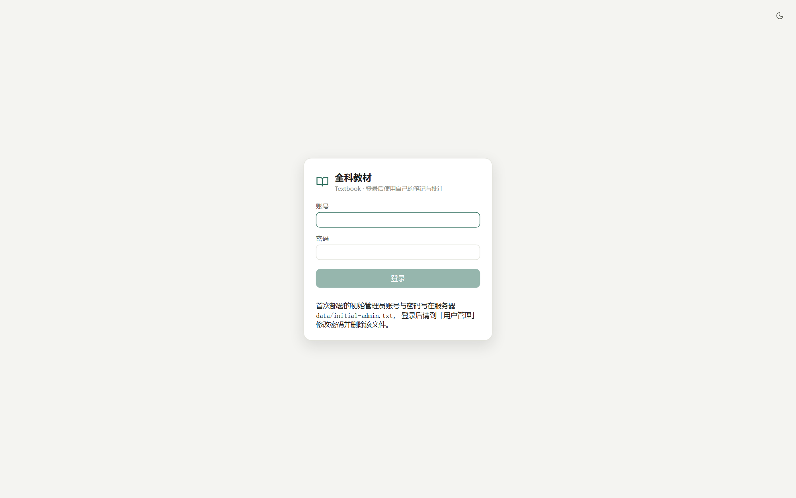
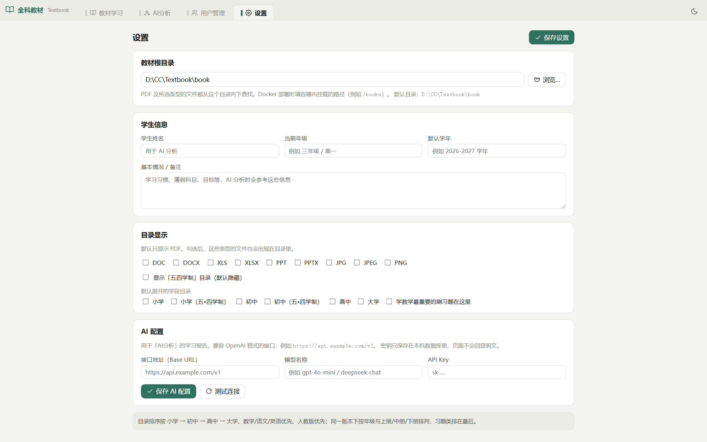
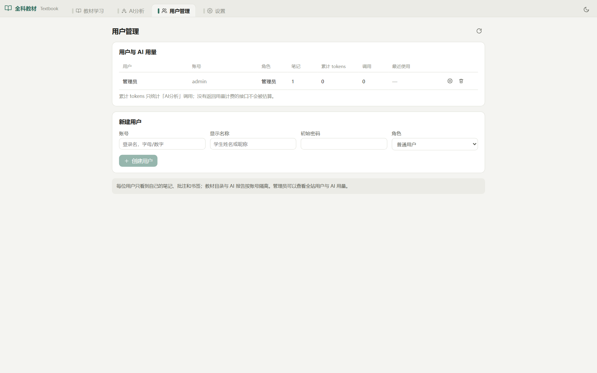
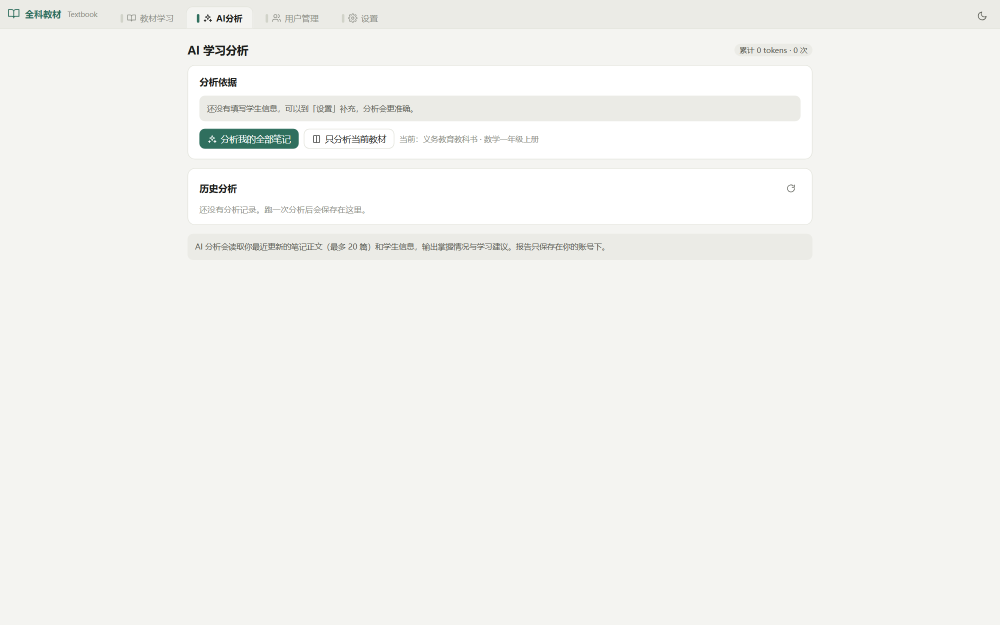

# 全科教材 Textbook

一套自托管的家庭教材阅读器：左侧是**目录**，中间是**教材 PDF**，右侧是**笔记**。直接在书上勾画、给每本书写富文本笔记、把笔记分享给家人，再让 AI 结合孩子的笔记和学生信息做一次学习分析。

浏览器打开即用，不需要客户端；一个 Node 进程 + 一个 SQLite 文件就是全部后端，没有原生依赖，也不需要编译。


## 功能

**读**

- PDF 逐页渲染（pdf.js），书架按「小学 → 初中 → 高中 → 大学 → 习题」排序，学科按「数学 / 语文 / 英语」优先，版本按「人教版 / 人民教育出版社 / 统编版」优先，其余收进「其他版本」；「五四学制」目录默认隐藏
- 没打开教材时，右栏显示所选目录下所有教材的第一页封面，点封面直接打开；封面就是 PDF 旁边的同名 JPG，由 `scripts/make-thumbs.py` 批量生成，浏览器缓存一天
- 阅读器右上角可下载原 PDF（练习册也适用）

**画**

- 悬浮画笔栏：铅笔、圆珠笔、蜡笔、马克笔、浅色记号笔、橡皮，外加直线、圆、矩形
- 每支笔单独记颜色（色板 + 光谱 + RGB + 透明度 + 常用色）、粗细（0.5–120）、不透明度，切回来还是上次的设置
- 笔画存在 PDF 旁边的旁注文件里（`<教材名>.marks.json`），跟着教材目录走，换电脑、换数据库都不丢；没有笔画时不写文件，清空后自动删除
- 书签：可命名、可跳页，标签能插进笔记，笔记里点标签跳回对应页

**记**

- 富文本笔记：字体、字号、颜色、标题、引用、列表、图片（本机上传 / 直接粘贴截图 / 粘贴 PDF 文字），实时保存
- 笔记可以导出 Word（.doc），可以分享：动态（跟着笔记更新）或静态（定格当前内容），有效期 7 / 14 / 30 天或永久，随时可关闭；分享链接不需要登录
- 进入教材后笔记栏自动展开；iPad 横屏和窄窗口下，目录与笔记收进抽屉，教材始终占最大面积

**分析**

- 【AI分析】读取最近更新的笔记和学生信息，输出掌握情况与学习建议；可以只分析当前这本，也可以分析全部笔记
- 支持任意 OpenAI 兼容接口（`/chat/completions`）。接口地址、模型名、API Key 在【设置】里填，Key 用 AES-256-GCM 加密后存在本机，页面上只回显末四位
- 每次调用记录 token 用量（只在服务商返回 usage 时记账，不估算）；【用户管理】里能看到每个用户的累计 token


## 快速开始

运行要求：**Node.js ≥ 22.5**（`node:sqlite`）。三端分发包已经把这个条件写进启动脚本，Windows / macOS 包自带生产依赖，解压即可离线运行。

把教材目录放在任意位置（例如 `D:\教材` 或 `/volume1/books`），首次登录后在【设置】里选一次即可。程序不会移动、改名或删除你的教材文件。

### Windows

1. 解压 `textbook-1.0.0-windows.zip`
2. 双击 `start-windows.cmd`
3. 浏览器打开 <http://127.0.0.1:9621/>

### macOS

1. 解压 `textbook-1.0.0-macos.zip`
2. 双击 `start-macos.command`。首次运行如被 Gatekeeper 拦下，右键 → 打开；或在终端执行 `chmod +x start-macos.command`
3. 浏览器打开 <http://127.0.0.1:9621/>

### Docker

```bash
docker compose up -d
```

`docker-compose.yml` 默认把 `./book` 挂到 `/books`、`./data` 挂到 `/data`。**教材目录必须是可写的**——批注旁注文件写在 PDF 旁边。宿主机上如果出现权限问题，把 `data/` 和教材目录的属主改成容器运行用户，或在 compose 里加 `user: "1000:1000"`。

也可以直接用镜像：

```bash
docker build -t textbook .
docker run -d --name textbook -p 9621:9621 \
  -v "$PWD/data:/data" -v "/path/to/books:/books" textbook
```

### 从源码运行

```bash
git clone https://github.com/in1912/Textbook.git
cd Textbook
npm install
npm run build:web      # 构建前端，并把 pdf.js 的 cmaps / 标准字体拷进 dist
npm start
```

### 首次登录

第一次启动会创建管理员，用户名 `admin`，随机密码写在数据目录下的 `initial-admin.txt`：

```
<解压目录>/data/initial-admin.txt      # 分发包 / 源码运行
/data/initial-admin.txt                # Docker
```

登录后到【用户管理】给自己重置一次密码（管理员重置不需要原密码），然后删掉这个文件。也可以用环境变量 `TEXTBOOK_ADMIN_PASS` 指定初始密码。



## 目录

```
book/
├── 小学/
│   ├── 数学/
│   │   ├── 人教版/
│   │   │   ├── 义务教育教科书 · 数学一年级上册.pdf
│   │   │   └── 义务教育教科书 · 数学一年级上册.jpg     ← 同名第一页封面
│   │   └── 其他版本/
│   ├── 语文/
│   └── …
├── 初中/
├── 高中/
├── 大学/
└── 学数学最重要的刷习题在这里/                          ← 习题目录排在最后
```

- **封面**：每个 PDF 旁边需要一张同名 `.jpg`（扩展名不含 `.pdf`）。打开目录时读的就是这张图，没有就显示占位。
- **排序**：学段顺序固定；同一学段内数学、语文、英语在前；版本按人教版优先；同一版本内按年级、然后按「上册 → 中册 → 下册」；中文数字会按数值比较（一 < 二 < … < 十 < 十一）。带「习题」字样的目录排在最后。
- **五四学制**：名称里带「五•四学制」的目录默认隐藏，可在【设置 → 目录显示】打开。
- **文件类型**：默认只列 PDF。可以在设置里勾选 doc / docx / xls / xlsx / ppt / pptx / jpg / jpeg / png；除 PDF 外只做列表和下载，不在页面里渲染。

## 配置

环境变量全部可选：

| 变量 | 默认值 | 说明 |
|---|---|---|
| `PORT` | `9621` | HTTP 端口 |
| `TEXTBOOK_DATA_DIR` | `<程序目录>/data` | 数据库、会话、AI 密钥、初始密码文件 |
| `TEXTBOOK_ROOT` | `<程序目录>/book`（存在时） | 默认教材根目录；也可以在【设置】里改 |
| `TEXTBOOK_SECRET` | 随机生成并写入 `data/secret.key` | 加密 AI Key 的主密钥，任意字符串（内部按 SHA-256 派生 32 字节） |
| `TEXTBOOK_ADMIN_PASS` | 随机 | 仅首次建库时生效的管理员密码 |
| `TEXTBOOK_WEB_DIST` | `<程序目录>/web/dist` | 前端构建产物位置（二次开发时用） |

【设置】页里还能配置：学生姓名、当前年级、默认学年、基本情况（这三项会作为 AI 分析的背景）、默认展开的学段目录。



## 多用户

- 角色只有两种：`admin` 和 `user`。管理员能管理用户、看不到别人的密码（只存 scrypt 哈希，可重置）。
- 每个用户的笔记、书签、分析报告、AI 用量互相隔离（`user_id` 维度）。
- 登录态是 30 天会话：`HttpOnly` Cookie，同时支持 `Authorization: Bearer` 和图片/PDF 用的 `?token=`。
- 同一 IP 连续 8 次登录失败锁定 5 分钟。



## AI 分析

在【设置 → AI 配置】里填接口地址（例如 `https://api.example.com/v1`）、模型名和 API Key，点「测试连接」确认可用。请求走 OpenAI 兼容的 `/chat/completions`：

- 超时 150 秒，对 408 / 429 / 5xx / 网络超时自动重试一次
- 兼容 DeepSeek 等把思考过程放在 `reasoning_content` 里的返回格式
- API 不返回 `usage` 时不记账，绝不用字数估算 token
- 连不上时错误信息会带上主机名和原因，不再只显示一句「失败」

【AI分析】有两个范围：只分析当前教材，或分析全部笔记（最多最近更新的 20 篇）。每次分析都会把学生信息一起带上，报告按用户保存在数据库里，可回看、可删除。



## 分享笔记

笔记右上角的分享按钮生成一个 24 字符的随机链接：

- **动态**：对方每次打开都看到最新内容；**静态**：定格分享那一刻的内容
- 可以附带教材页面（只读，不需要登录），也可以只分享笔记
- 有效期 7 / 14 / 30 天或永久，随时可关闭，关闭后链接立即失效
- 公开接口只读，未授权访问返回 404/403，不会泄露教材目录结构

## 与个人工作台集成

这套系统同时也是个人工作台的「学习 → 教材」tab。两边共用同一份源码：

- `server/{router,books,marks,schema}.js` 是纯路由 + 数据层，由 `createRouter(ctx)` 接收数据库和 AI 适配器；工作台传入租户库、自己的用户表和 AI 服务
- 工作台把构建产物托管在 `/textbook/`，tab 里是同源 iframe，共用工作台登录态；接口在 `/api/textbook/*`，权限归 `learning/textbook`
- 工作台里只读用户列表（`manage_users: false`）、AI 配置沿用工作台设置（`ai_config: false`）

改动教材系统时，先改独立版 `D:\CC\Textbook`，再同步到工作台：

```bash
node scripts/sync-workbench.mjs            # 拷 server/*.js + web/dist → 工作台
node scripts/sync-workbench.mjs --check    # 只检查是否有漂移（CI/提交前用）
```

## 开发

```bash
npm run build:web      # 前端：Vite + Vue 3，产物在 web/dist
npm start              # 后端：Express，静态托管 web/dist
npm run pack:all       # 打三端包（需要先 build:web）
```

目录结构：

```
server/
├── index.js     独立端入口：登录、静态托管、/api/textbook + /api/admin
├── router.js    教材 API（独立端与工作台共用，createRouter(ctx)）
├── books.js     目录树、排序、封面缓存
├── marks.js     旁注文件读写（原子替换 + 按文件串行锁）
├── auth.js      scrypt 密码、会话、Cookie
├── ai.js        OpenAI 兼容客户端 + Key 加解密 + 用量记账
├── admin.js     独立端用户与 AI 配置管理
├── db.js        node:sqlite 连接与数据目录
└── schema.js    tb_* 表结构（幂等建表）
web/              Vue 3 + Vite 前端
scripts/          sync-workbench.mjs / build-packages.mjs / zip-utf8.py
```

前端构建时会把 `pdfjs-dist` 的 169 个 cMap 和 16 个标准字体拷到 `web/public/pdfjs/`，再由 Vite 原样带进 `dist/`。**中文教材没有这些文件会渲染成空白字形**，所以打补丁/换构建流程时不要漏掉这一步。

## 数据与备份

| 位置 | 内容 |
|---|---|
| `data/textbook.sqlite` | 用户、设置、笔记、书签、分享、AI 报告与用量 |
| `data/secret.key` | 加密 AI Key 的主密钥（首次启动生成；丢了需要重新填 Key） |
| `data/initial-admin.txt` | 首次启动的管理员初始密码（登录后应删除） |
| 教材目录旁的 `*.marks.json` | 该教材的笔画批注 |

备份 = 拷走 `data/` 目录（`textbook.sqlite` 使用 WAL 模式，复制前先停服务或执行 `sqlite3 textbook.sqlite '.backup backup.sqlite'`）。教材本身不需要备份到本系统——它始终是磁盘上的一组普通文件。

## 常见问题

**页面提示「前端还没有构建」**
源码运行时没执行 `npm run build:web`，或者 `web/dist` 被删了。分发包里已经带好构建产物，不会出现这个提示。

**Node 版本报错 `node:sqlite` 不存在**
需要 Node ≥ 22.5。启动脚本已经带 `--experimental-sqlite`（Node 24 上也兼容），如果自己写systemd/服务命令，请保留这个参数。

**中文显示成方块或空白**
`web/dist/pdfjs/` 不完整。重新执行 `npm run build:web`——它会重新拷贝 cMaps 和标准字体。

**批注保存失败 / Docker 里画不上**
教材目录必须可写，旁注文件写在 PDF 旁边。只读挂载（`:ro`）时只能看不能画。

**端口被占用**
`PORT=9700 npm start`，或在启动脚本里设置环境变量。

**能放到公网吗**
设计目标是家庭局域网或 VPN 内使用。要暴露到公网，请放在 HTTPS 反向代理后面，并限制来源 IP；分享链接本身可以匿名访问，属于预期行为。

## 许可与致谢

MIT License，见 [LICENSE](LICENSE)。

教材内容不随本仓库分发；仓库和分发包都不包含任何教材文件，教材目录由使用者在【设置】里自行指定。示例截图中的教材来自公开的教育部审定电子课本，版权归原出版方所有。感谢 [TapXWorld/ChinaTextbook](https://github.com/TapXWorld/ChinaTextbook) 等公开教材整理项目为家庭自学提供的便利。
